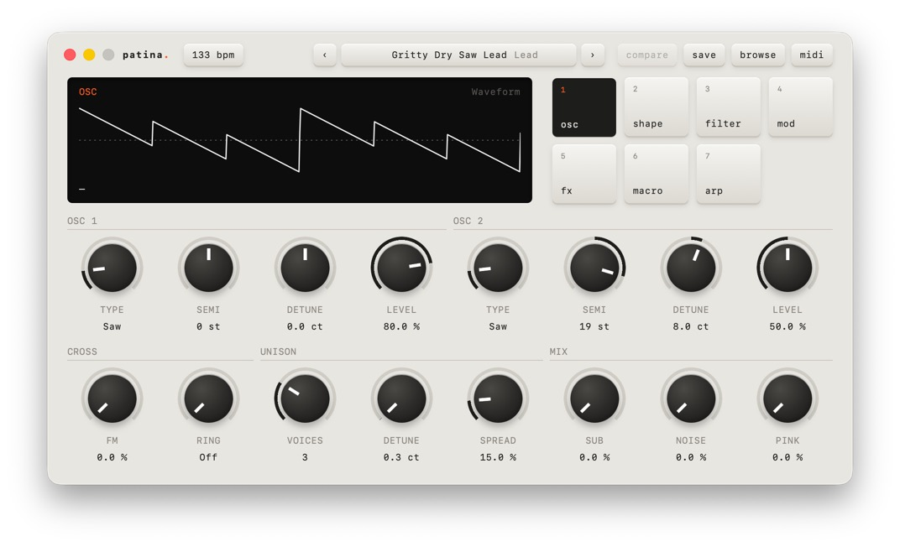

# Patina

A polysynth plugin (VST3 + CLAP) for macOS and Windows, and a Mac app, in
Rust, built with [nice-plug](https://codeberg.org/RustAudio/nice-plug), pinned to
[a fork](https://github.com/starzonmyarmz/nice-plug/tree/patina) that adds one
commit: `ActivateContext::gui_context()`, so MIDI controllers can set
parameters before the editor opens. See [SPEC.md](SPEC.md) for the design and
build order.



## Download

Download `Patina-<version>.zip` from the
[latest release](https://github.com/starzonmyarmz/patina/releases/latest). It
holds VST3 and CLAP for macOS (Apple Silicon and Intel) and Windows, and
[INSTALL.txt](INSTALL.txt), which says where to copy them and what to do when
macOS or Windows flags them as unsafe.

## Releasing

Versions follow [semver](https://semver.org). The version lives once, in the
root `Cargo.toml`, and it’s what hosts see as the plugin’s version.

- **Major**: anything that breaks saved projects or presets, such as
  renaming or removing a parameter ID or changing a parameter’s range.
- **Minor**: new features, parameters or factory presets.
- **Patch**: fixes that don’t change how saved projects sound.

To release, bump the version, commit, then tag and push:

```sh
git tag v1.1.0
git push origin v1.1.0
```

The tag starts the release workflow, which checks that the tag matches
`Cargo.toml`, builds both platforms and publishes `Patina-1.1.0.zip`. A
version with a suffix, like `1.1.0-beta.1`, is published as a prerelease.

## Build and install on macOS

```sh
./scripts/install.sh
```

Builds release bundles and copies them, ad-hoc signed, to
`~/Library/Audio/Plug-Ins/VST3` and `~/Library/Audio/Plug-Ins/CLAP`. In
REAPER, rescan plugins (**Preferences → Plug-ins → VST/CLAP → Re-scan**) and
add **Patina** to a track. Prefer the CLAP version.

It also builds `/Applications/Patina.app`, the same synth without a DAW.

## The app

The app plays through CoreAudio and takes MIDI from the MiniLab when it's
connected (otherwise the first MIDI input). **midi** lists the audio
outputs and MIDI inputs; choosing others restarts the app with them. A
device plugged in after launch shows up the next time the dialog opens.

It reopens with the sound you left: the preset, your edits and the
unsaved-changes dot. The transport always runs at 120 BPM, so synced LFOs,
delays and audition phrases use that. Quit with Cmd Q or by closing the
window.

## Using it

- **Pages**: seven keys (or 1–7 on the keyboard) switch the 16 knobs between
  Osc, Shape, Filter, Mod, FX, Macro and Arp. The screen draws whatever the last
  touched knob controls: waveform, filter curve, envelope, LFO, echoes, EQ.
- **Knobs**: drag up/down (Shift for fine), scroll, or arrow keys when
  focused. Double-click resets. Click a switch knob to toggle it.
- **Presets**: ‹ › (or [ ]) step through the browser's current filter.
  Click the preset name or **browse** to search, filter by category and
  star favorites. Arrow keys in the search box audition presets.
- **Saving**: **save** writes a user preset to
  `~/Library/Audio/Presets/Patina/User/`. Factory presets are never
  changed. The orange dot means unsaved changes; **compare** flips between
  your edit and the saved preset.

## Curating the factory bank

Shift A in the editor turns on audition mode. The plugin loops a short
phrase that suits the preset's category (it follows the host tempo, and
plays with the transport stopped), and the page keys become **keep**,
**tweak**, **cut**, **replay**, **skip** and **exit** (k, t, c, r, n).
Rating moves on to the next preset; **skip** jumps to the next unrated one,
and the browser gets an Unrated filter. On the MiniLab, pad bank 2 does the
same.

Rate a **tweak** after turning knobs and the edited sound is kept with the
verdict. Verdicts go to `~/Library/Application Support/Patina/ratings.json`.
The generator merges them into `presets/ratings.json` (commit that file),
drops every cut preset, applies tweaks that carry an edit, and lists the
tweaks still waiting for one:

```sh
cargo run --release -p presetgen
```

Verdicts are keyed by preset name, so changing the generator can orphan
them; it warns about any that no longer match. Clearing a verdict in the
plugin doesn't clear one already merged into the repo: edit
`presets/ratings.json` for that.

## MiniLab MK2

Store the setup in [docs/minilab-setup.md](docs/minilab-setup.md) in one of
the MiniLab’s memories with MIDI Control Center; Patina never writes to the
device. Knobs follow the page on screen, finer while knob 1 or 9 is held; bank
1 pads switch pages. Pad 8 turns knob 1 into a preset dial and knob 2 into the
browser's filter.

## Working on the UI

```sh
cargo run -p patina --example ui_mock         # writes ui/dev/mock.json
cd ui && python3 -m http.server 8765         # open http://localhost:8765
```

Outside the plugin the page talks to a mock bridge built from the real
parameter table, page layout and factory bank.

## Test

```sh
cargo test -p patina
cargo test --release -p patina --test engine -- --ignored --nocapture   # CPU budget
```

## Factory presets

```sh
cargo run --release -p presetgen
```

Rewrites `presets/factory.json`, which is compiled into the plugin. The
generator starts from hand-designed archetypes in
`presetgen/src/archetypes.rs`, makes seeded variations, assigns each
category's macros, then renders every preset through the engine: it
rejects silent, broken or DC-offset presets, sets each one's volume to the
same loudness, and checks that all macros at full stay clean.

## Layout

| Path | What |
|---|---|
| `plugin/src/params.rs` | The parameter table: IDs, ranges, defaults. Single source of truth. |
| `plugin/src/engine/` | DSP: band-limited oscillators, filters, envelopes, LFOs, voices. |
| `plugin/src/lib.rs` | nice-plug wrapper: MIDI handling, sample-accurate event splitting. |
| `plugin/src/layout.rs` | Which parameter sits under each of the 16 knobs on each page. |
| `plugin/src/library.rs` | Preset keys, favorites, saving and deleting user presets. |
| `plugin/src/bridge.rs` | The editor's message protocol: values, presets, session, compare. |
| `plugin/src/editor.rs` | The webview window and keyboard forwarding. |
| `ui/index.html` | The whole interface: plain HTML, CSS and JavaScript. |
| `plugin/src/minilab.rs` | MiniLab CC numbers and relative encoder decoding. |
| `plugin/src/controls.rs` | Hardware state shared by the audio thread, the GUI-thread task and the editor. |
| `plugin/src/macros.rs` | Per-preset macro matrix. |
| `plugin/src/presets.rs` | Preset format, factory bank, user preset files, the session saved with projects. |
| `plugin/tests/engine.rs` | Offline render tests and the CPU benchmark. |
| `presetgen/` | Factory bank generator and quality gate. |
| `app/` | The Mac app: device choice, then nice-plug's standalone wrapper. |
| `plugin/src/app.rs` | What the editor needs from the app: device lists, relaunch, saving the sound. |
